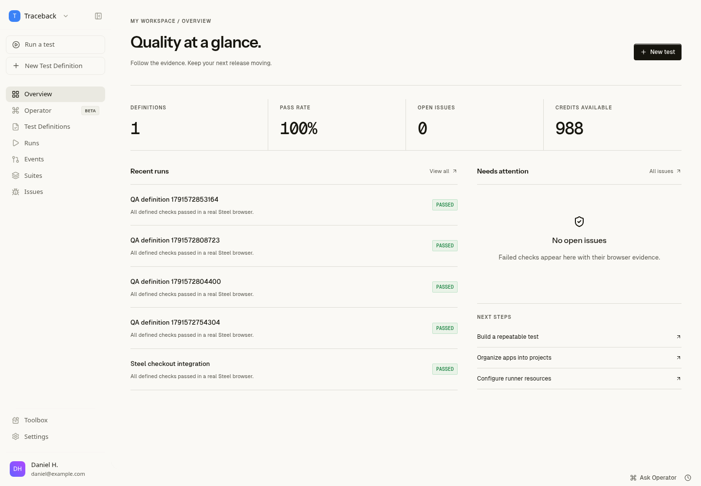

# Traceback v2

A self-hosted QA workspace with real browser runs powered by [Steel Browser](https://github.com/steel-dev/steel-browser). React/Vite, Express, SQLite, and Playwright over Steel CDP. Adapted from the existing traceback-operator application.



## Run locally

Requires Node 22+, npm, and Docker. Install dependencies with `npm ci`, copy `.env.example` to `.env`, and start Steel:

```sh
docker run -d --name traceback-steel -p 3000:3000 -p 9223:9223 --add-host host.docker.internal:host-gateway -e DOMAIN=localhost:3000 -e CDP_DOMAIN=localhost:9223 ghcr.io/steel-dev/steel-browser-api@sha256:459919842ab1aac5201e33331fc070a13106edd26d968fc7551adcff334b54cf
npm run dev
```

Open http://localhost:5173. Database migrations and an empty owner workspace are created automatically. Local development without `TRACEBACK_PASSWORD` permits local access. Set a password before exposing the server. Browser targets must be reachable from Steel; use `host.docker.internal` for services on the Docker host. The browser runner serializes sessions for this self-hosted Steel distribution.

Autonomous tests, natural-language steps, step generation, and suggested selector repairs require `OPENAI_API_KEY`. Explicit CSS/text deterministic steps work without an AI key. Configure keys in environment secrets, never in source control. Missing dependencies produce blocked runs or an explicit unavailable response rather than simulated success.

## Production

Set `TRACEBACK_PASSWORD` and a stable `SECRET_ENCRYPTION_KEY`, then run `docker compose up --build -d`. Compose exposes the app on localhost:3001 and stores SQLite and screenshots in a named volume. Put a TLS reverse proxy in front of it, set `COOKIE_SECURE=true`, and set `ALLOWED_ORIGINS` to the public origin. Back up the complete volume and preserve the encryption key. Restarting the process invalidates login sessions; interrupted runs are marked blocked and can be rerun. `npm run build && NODE_ENV=production npm start` also serves the built frontend.

GitHub issue export requires `GITHUB_TOKEN` and `GITHUB_REPOSITORY=owner/repo`; Linear requires `LINEAR_API_KEY` and `LINEAR_TEAM_ID`. Tokens stay on the server. Saved credentials are encrypted and returned masked. API keys are displayed only once, stored hashed, and revocable.

## Implemented scope

- Persisted project and workspace views, tests, suites, issues, usage, and run history; empty, loading, missing-record, and error states.
- Autonomous and deterministic definitions, multiple viewports, sequential suites, actual screenshots and action timelines, JSON reports, and failure issues.
- Pause/resume without replay, budget extension, cancellation, bounded AI actions, navigation restrictions, and explicit review/application of suggested selector repairs.
- Owner password access, origin checks, encrypted test credentials, hashed API keys, and optional real GitHub/Linear issue export.
- Responsive warm surfaces and restrained tactile controls informed by Linear, Notion, and Apple's early Aqua design. See [design research](docs/design-system.md) and [browser research](docs/browser-research.md).

This release is a single-owner deployment. Multi-user organizations, invitations, paid billing, OAuth, scheduler/webhook triggers, Slack/Jira delivery, connected MCP execution, and PDF reports from the broader roadmap are not implemented. Their relevant screens report availability honestly. It is not a completed multi-tenant SaaS release. Autonomous execution and third-party exports have not been verified against live credentials in this workspace.

## Verification

```sh
npm run check
npm test
node scripts/qa-fixture.mjs
# In separate terminals: Steel and npm run dev
node scripts/runner-regression.mjs
npm run test:e2e
npm run build
```

The browser suite covers desktop and mobile routes, project views, editor persistence, report tabs, project isolation, project creation, unavailable records, and API recovery. The runner regression uses actual Steel sessions to verify screenshots, product failures, budget pause/resume, cancellation, viewport expansion, and suite aggregation. It creates temporary definitions and archives them afterward. Tests use a disposable fixture; do not point regressions at production. CI runs the same checks against the pinned upstream Steel image. Local run artifacts are ignored by Git.
