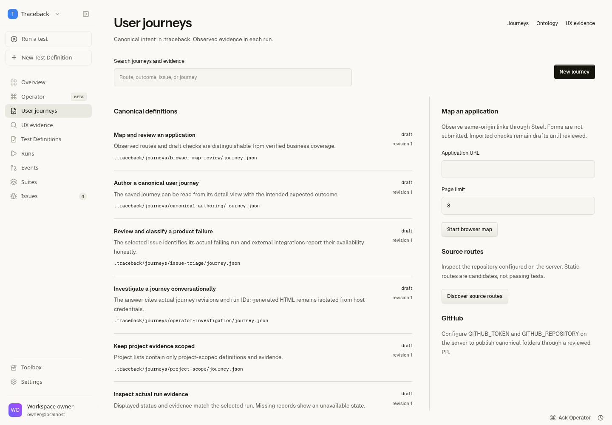

# Traceback v2.1

Canonical QA intent in `.traceback`, exposed primarily through MCP and CLI, with a responsive investigation workspace and real [Steel Browser](https://github.com/steel-dev/steel-browser) execution.

Each user journey has its own versioned folder. A shared ontology describes actors, entities, routes, and relationships. The GUI, CLI, MCP, and Operator use the same definitions and services. Runs preserve the exact definition revision/hash and synthetic profile used; screenshots and logs remain runtime evidence, not another source of intent.



## Start locally

Requires Node 22+, npm, and Docker. Run `npm ci`, copy `.env.example` to `.env`, then start Steel:

```sh
docker run -d --name traceback-steel -p 3000:3000 -p 9223:9223 --add-host host.docker.internal:host-gateway -e DOMAIN=localhost:3000 -e CDP_DOMAIN=localhost:9223 ghcr.io/steel-dev/steel-browser-api@sha256:459919842ab1aac5201e33331fc070a13106edd26d968fc7551adcff334b54cf
npm run dev
```

Open http://localhost:5173. Database migrations and owner workspace initialization run automatically. Authored self-QA journeys remain drafts and are never executed automatically. Without `TRACEBACK_PASSWORD`, development permits local access. Configure a password before exposing the server.

Browser targets must be reachable from Steel. Use `host.docker.internal` for services on the Docker host, with an intentionally configured target bind address. Sessions are serialized within the application process for this Steel distribution.

## Primary interface: MCP and CLI

```sh
npm link
traceback journeys list
traceback journeys run JOURNEY_ID --persona mobile
traceback mcp
```

MCP supports stdio and authenticated stateless Streamable HTTP at `/api/mcp`. It exposes canonical authoring, ontology, discovery, mapping, execution/control, search, UX analysis, real screenshot image content, GitHub journey PRs, and Congruence fix planning. Create a workspace API key in Settings and inject it as `TRACEBACK_API_KEY`; point `TRACEBACK_API_URL` at your server. See [connection examples and command reference](docs/mcp-cli.md).

## Investigation workflows

- **Journeys:** versioned goals, expected outcomes, steps, actors, routes, provenance, and optimistic saves. Existing definitions refuse stale overwrites.
- **Mapping:** inspect local source or configured GitHub routes, traverse bounded same-origin links with Steel, review screenshots and controls, import draft reachability checks, or infer unverified business journey hypotheses with AI. Mapping does not prove complete business coverage.
- **UX evidence:** run standard, mobile, first-time, or keyboard synthetic profiles. Review actual failures, long observation intervals, repeated interactions, and stale revisions. Synthetic observations are not human satisfaction or conversion metrics.
- **Operator:** investigate actual workspace and canonical evidence conversationally. Rich artifacts use a sandboxed OpenIntelligentUI-derived renderer rather than host HTML injection. Host controls validate follow-up/link actions.
- **Execution:** autonomous or deterministic browser runs, multiple viewports, sequential suites, screenshots, timelines, reports, issue evidence, pause/resume without replay, budget extension, cancellation, and reviewed selector repair.
- **GitHub:** publish canonical journey folders and ontology through a new branch and PR. Runtime evidence and secrets are excluded. Actual issue export also supports configured GitHub and Linear.
- **Autofix:** prepare a Congruence code-edit/retest/draft-PR workflow from an observed failed canonical journey. Live code editing is not enabled without an agreed adapter. See [the contract and repair gates](docs/autofix.md).

## Configuration and production

Autonomous execution, Operator, natural-language steps, and workflow inference require `OPENAI_API_KEY`. Explicit deterministic steps, mapping, ontology, search, CLI/MCP, and rule-based UX analysis work without an AI key. Missing dependencies produce blocked runs or explicit unavailable responses.

`TRACEBACK_ROOT` selects the canonical folder; `TRACEBACK_REPO_ROOT` selects the local source checkout to inspect. `GITHUB_TOKEN` and `GITHUB_REPOSITORY=owner/repo` enable remote route discovery, journey PRs, and issue export. Linear issue export uses `LINEAR_API_KEY` and `LINEAR_TEAM_ID`. Keep credentials in environment secrets, never canonical files. Stored browser credentials are encrypted; workspace API keys are hashed, shown once, and revocable.

Set `TRACEBACK_PASSWORD` and a stable `SECRET_ENCRYPTION_KEY`, then run `docker compose up --build -d`. Compose binds localhost:3001 and persists runtime data and canonical files in separate named volumes. Back up both. Put a TLS reverse proxy in front, set `COOKIE_SECURE=true`, and configure `ALLOWED_ORIGINS`. Preserve the encryption key. Login sessions expire on process restart; interrupted runs/maps become blocked and can be restarted. Use one application process per canonical folder. See [.traceback operations](.traceback/README.md) for canonical write-lock recovery.

This remains a single-owner deployment. Multi-user organizations, invitations, paid billing, OAuth, scheduler/webhook triggers, Slack/Jira delivery, arbitrary external MCP execution, and PDF reports from the broader roadmap are not implemented. Relevant screens state availability. Live autonomous model behavior and third-party exports have not been verified with production credentials in this workspace.

## Design and verification

[DESIGN.md](DESIGN.md) records the requested monitoring/investigation direction. [Research](docs/design-system.md) covers Linear, Notion, early Apple Aqua, anti-slop, and the OpenIntelligentUI integration. [Browser research](docs/browser-research.md) documents Steel, QAWolf, Stagehand, and browser-use references.

```sh
npm run check
npm test
# Start Steel, npm run dev, and node scripts/qa-fixture.mjs separately
node scripts/runner-regression.mjs
node scripts/journey-regression.mjs
npm run test:e2e
npm run build
docker build -t traceback-v2:qa .
python3 scripts/container-smoke.py
```

CI repeats unit/security, MCP, real Steel execution, desktop/mobile routes and interactions, production compilation, and container startup verification. The journey regression uses an isolated database and canonical folder. Browser tests use temporary QA definitions and a disposable fixture; do not point them at production. See [verification scope and results](docs/verification.md). A dependency audit and browser tests support concrete checks, not a claim that every possible website or human journey is covered.
